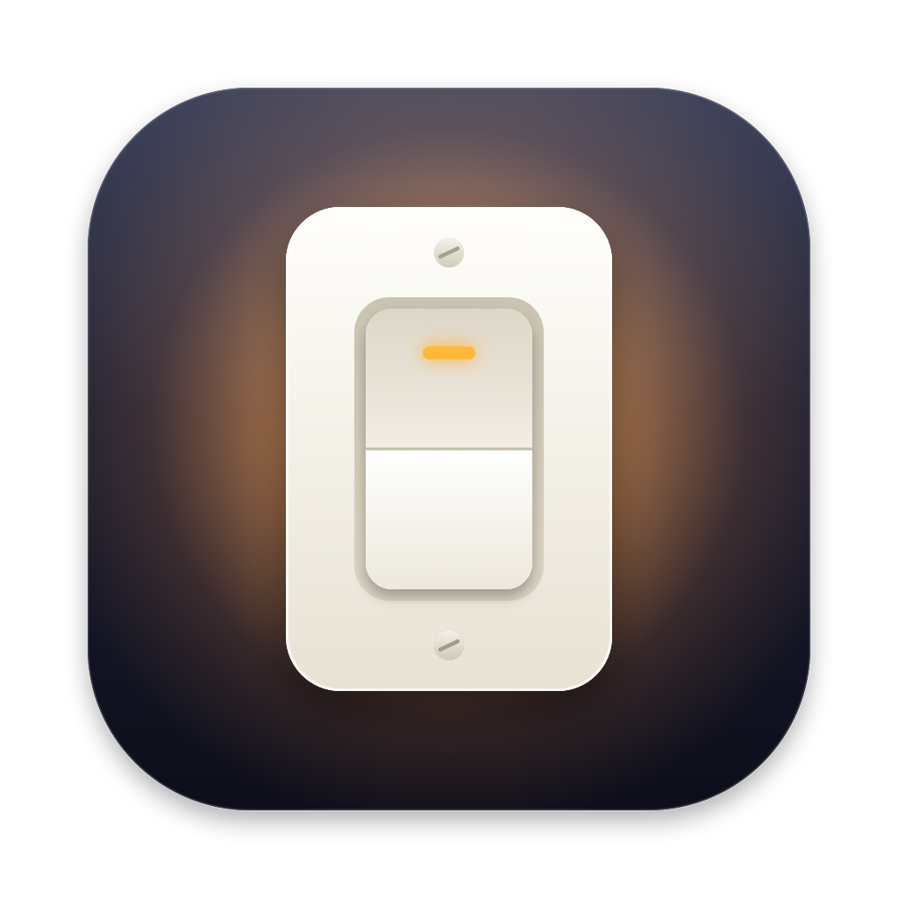
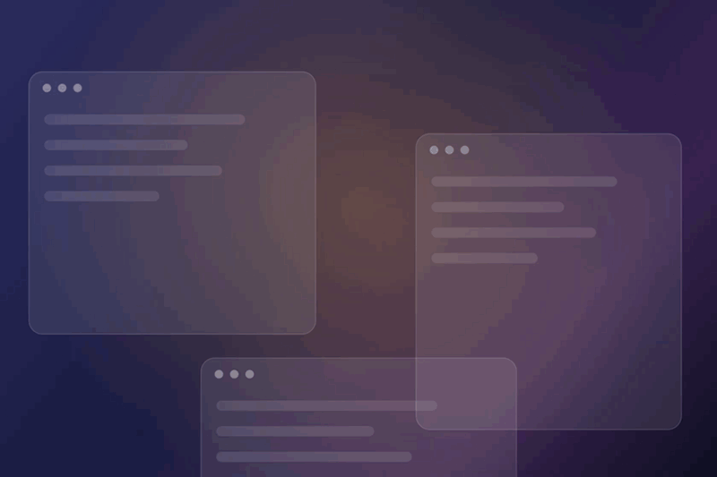

# Lightswitch

**[aftab404.github.io/lightswitch](https://aftab404.github.io/lightswitch/)**



Spotlight-style fuzzy window switcher that finds browser tabs and opens apps too. Press ⌘Space (or a shortcut you pick) and start typing a window title, browser tab or app name. Tabs open in Chrome, Safari, Brave, Arc, Edge, Vivaldi and Chromium are listed too, each browser window as its tabs, and typing matches them on their title or address. Installed apps that aren't running yet are listed under Applications, below the matching windows and tabs. Tab / Shift-Tab (or ↑/↓, ⌃N/⌃P) move the selection, Return jumps to that window or tab or opens that app, ⌘W closes the selected window or tab, ⌘Q quits its app, and Esc clears the query or closes the panel.

## Download

**[Download Lightswitch.dmg](https://github.com/aftab404/lightswitch/releases/latest/download/Lightswitch.dmg)** (macOS 14 or later, Apple silicon and Intel). Open it and drag Lightswitch into Applications.

The app isn't notarized by Apple yet, so the first launch needs one extra confirmation:

1. Open Lightswitch. macOS says it was not opened because it can't verify the developer. Click **Done**.
2. Open System Settings → Privacy & Security and scroll down to the Security section.
3. Next to the message about Lightswitch, click **Open Anyway**, then confirm with your password or Touch ID.

You only do this once per version. Lightswitch then opens its welcome window, which walks you through the one-time setup below.

## Build from source

```bash
./build.sh install
```

This builds `build/Lightswitch.app`, copies it to `~/Applications`, and launches it. It needs the Xcode Command Line Tools (`xcode-select --install`). `./build.sh dmg` builds a universal app and packages it as `build/Lightswitch.dmg` for release. `demo/record.sh` records the demo above with sample windows, tabs and apps (it needs Screen Recording permission) and writes `media/lightswitch-demo.mp4` and `.gif`; `demo/record.sh stills` captures stills of the panel and lays out the Product Hunt images in `media/producthunt` and the site's share image, `assets/og.png`.

Either way, the app runs as a menu bar item and starts at login once it's in an Applications folder. You can turn that off in the menu.

## One-time setup

The first time Lightswitch starts, its welcome window takes you through these steps and ticks each one off as it's done. You can open it again with **Setup…** from the menu bar icon.

1. **Accessibility:** click **Allow Access…**, then switch on Lightswitch in System Settings → Privacy & Security → Accessibility. It needs this to read window titles and raise windows.
2. **Free up ⌘Space, or pick another shortcut:** Spotlight uses ⌘Space out of the box, and macOS's own shortcuts come first. Lightswitch opens apps as well, so handing it ⌘Space doesn't cost you Spotlight's app launching: click **Open Keyboard Settings**, go to Keyboard Shortcuts… → Spotlight and uncheck "Show Spotlight search" (or give Spotlight another shortcut), and Lightswitch takes ⌘Space over as soon as it's free. Or keep Spotlight and click **Use ⌥Space**, or **Choose Another…** to press a combination of your own. **Change Shortcut…** in the menu bar icon changes it later. If macOS takes Lightswitch's shortcut for something else on a later launch, Lightswitch tells you what and takes the shortcut over as soon as it's free.
3. **Browser tabs (optional):** each supported browser that's running gets an **Allow…** button, which brings up macOS's prompt asking whether Lightswitch may control it. Allow it to search that browser's tabs. If you don't, its windows are listed as before; you can change your mind in System Settings → Privacy & Security → Automation → Lightswitch. A browser you haven't been asked about, such as one that wasn't running, gets the prompt the first time you open the panel while it runs.
4. **Try it:** press your shortcut and type a few letters of a window, tab or app.

The build is ad-hoc signed, so every rebuild changes its signature and macOS drops the Accessibility grant. After a rebuild or an update, Lightswitch opens the welcome window again at launch: click **Allow Access…** there (or **Grant Accessibility Access…** in the menu bar icon, or **Allow…** in the panel). It clears the stale entry so macOS asks again. macOS also asks again for permission to control each browser, which the welcome window's **Allow…** buttons cover too. To avoid both, create a self-signed code signing certificate named "Lightswitch Dev" in Keychain Access; `build.sh` uses it automatically.

The icon is drawn by `icon/make-icon.swift`; run `swift icon/make-icon.swift` to regenerate `icon/AppIcon.icns` after changing it.

## Notes

- Windows come from the Accessibility API, which lists the current Space's windows and minimized ones. On other Spaces and in full screen it can only reach each app's main window, the one you used last, so that's the window listed for the app there, along with the window you came from. Apps with no window it can reach, including apps without windows, appear as an "App" row; selecting one does what clicking the app in the Dock does: macOS switches to a Space with its windows, and an app without any, such as Chrome after you closed its last tab, opens a new one.
- With an empty query, the window you were in before this one is second and preselected, so ⌘Space then Return toggles between your last two windows: across desktops and full screen, between two windows of the same app, and however you switched (Lightswitch, ⌘Tab or a click). Lightswitch follows which window has focus; if the one you came from has been closed, minimized or hidden since, it takes the one before that. The rest of the list is this desktop's windows in on-screen stacking order, with windows on other desktops or in full screen placed by how recently you used their app (the order ⌘Tab shows). Minimized windows, hidden apps and apps without windows come after all of this desktop's windows. Until Lightswitch has seen you switch once after it starts, it preselects the second row of that list.
- Browser tabs come from the browsers' AppleScript support, read over Apple Events in the background each time the panel opens. They're usually ready before the window list is; if a browser is slower, the list waits up to a tenth of a second for it, then shows its windows and switches them to tabs when they arrive. Only browsers that are already running are asked; Lightswitch never launches one, and a browser that doesn't answer within two seconds is skipped. A browser's window rows are replaced by its tabs, each window's tabs where its row was, starting with its current tab (which is the window's own row, so the previous window is still preselected as its current tab). Windows the browser lists no tabs for, such as Safari's Settings, keep their rows, and tabs in windows Lightswitch has no row for, such as ones on another desktop, come after the browser's other rows. While you type, at most 10 tabs that aren't their window's current tab are listed, so the apps below stay in view. A tab matches on its title and browser name like a window does, or on its address (domain and path) where the term appears unbroken, so "jira" finds a Jira board whose title doesn't say Jira. Return makes the tab current, brings its window to the front and activates the browser. If reading a browser fails, for example because its permission was denied, its windows are listed as usual. Firefox isn't supported: it has no scripting access to its tabs.
- ⌘W closes the selected window, as its close button would, or the selected tab. ⌘Q quits the app the selected window or tab belongs to (for a tab, the browser), as the app's own Quit would. The panel stays open with the next row selected, so you can close several in a row. Apps still get to ask about unsaved changes: a window that asks keeps its row until you've answered (Return takes you to it), and an app's rows go once it has quit. ⌘W never quits an app; on an app's row it just beeps, as ⌘Q does on an app that isn't running. Closed the wrong one? ⌘⇧T in the browser reopens the last closed tab or window.
- Apps come from `/Applications`, `/System/Applications` and `~/Applications` (including folders one level down, such as Utilities), plus Finder. Lightswitch lists them in the background at launch, and again when you open the panel if that list is a few minutes old or one of those folders has changed. Running apps aren't repeated under Applications, since they're already in the window list.

## License

MIT. See [LICENSE](LICENSE).
